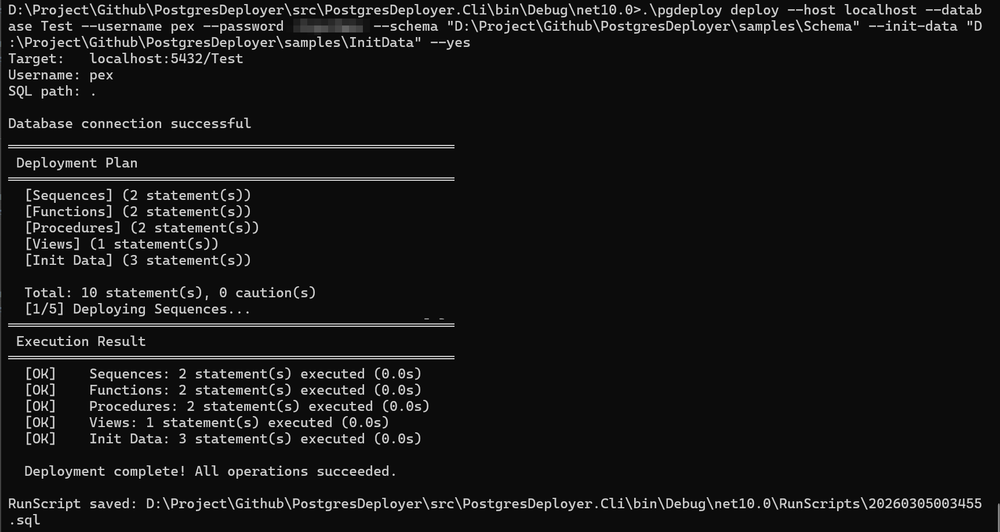
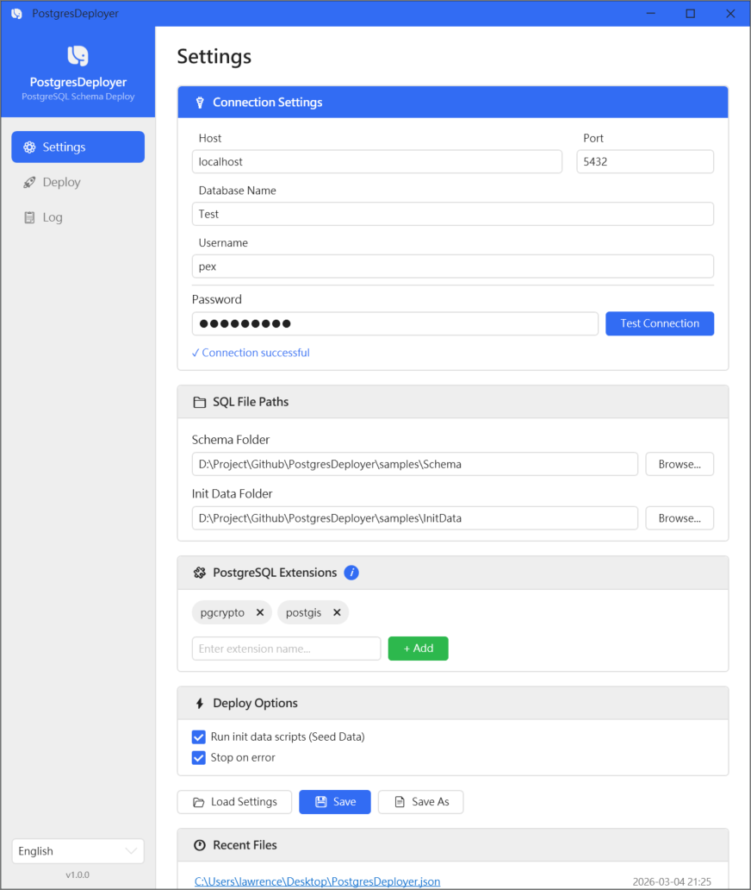
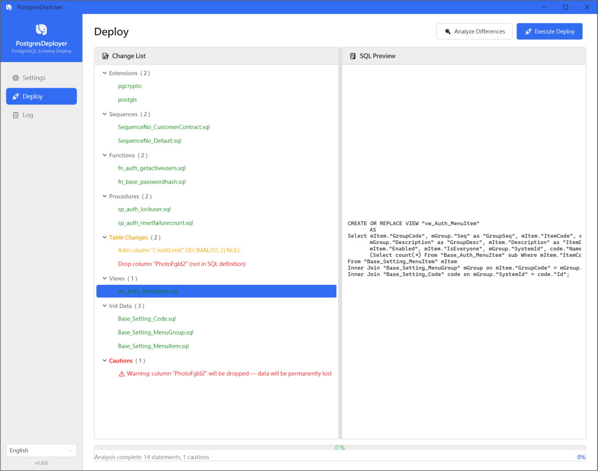
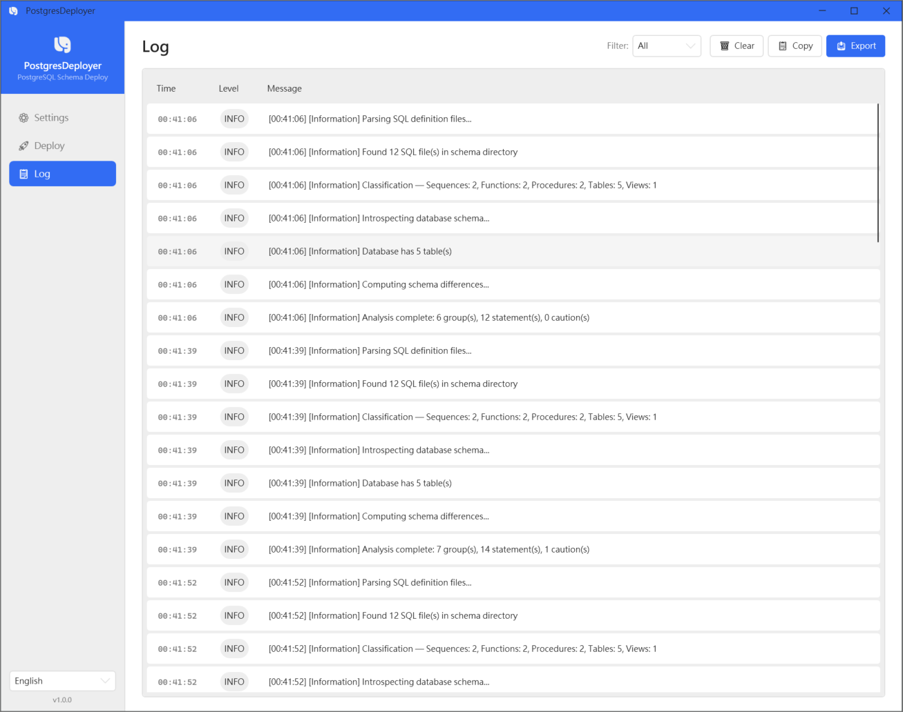

[English](README.md) | [繁體中文](README.zh-TW.md)

# PostgresDeployer


A general-purpose PostgreSQL schema deployment tool — define your database schema in SQL files, and let PostgresDeployer automatically detect and apply the differences each time you deploy.

Inspired by MSSQL SSDT/DACPAC, built for PostgreSQL.

## Table of Contents

- [Why PostgresDeployer?](#why-postgresdeployer)
- [Features](#features)
- [Screenshots](#screenshots)
- [Getting Started](#getting-started)
- [Quick Start: Sample Project](#quick-start-sample-project)
- [CLI Usage](#cli-usage)
- [WPF Desktop Application](#wpf-desktop-application)
- [Supported Schema Changes](#supported-schema-changes)
- [Contributing](#contributing)
- [License](#license)

## Why PostgresDeployer?

Visual Studio's **SQL Server Database Projects** offer an excellent developer experience for managing database schemas — every database object lives in its own file, changes are tracked in Git, and deployment automatically computes the diff. The problem is it only works with **Microsoft SQL Server**.

Migration-based tools like **Flyway** and **Liquibase** support PostgreSQL and are widely used, but they take a fundamentally different approach: each change is a versioned migration script, so the current definition of a table is scattered across tens or hundreds of files.

PostgresDeployer takes the **desired state** approach:

- **Single Truth:** Each table is a single `.sql` file that always reflects the **complete, current structure**.
- **Clear History:** Git history on that file shows the complete evolution of the table over time.
- **Auto Diff:** PostgresDeployer compares your **desired schema** with the **actual database schema**, generating and applying only the incremental changes needed.
- **Idempotent:** Running multiple times produces the same result. No migration scripts to maintain.

## Features

- Automatic schema diff detection (tables, columns, types, nullability, defaults, indexes, primary keys)
- Safe, transaction-based deployment with automatic rollback on failure
- Dry-run mode to preview changes without applying them
- Caution warnings for potentially destructive operations
- Deployment is blocked (exit code 1) when a `DROP VIEW ... CASCADE` would drop views that are not in the schema directory — opt in with `--allow-cascade-drop`
- Seed data support via MERGE statements
- PostgreSQL extension management (e.g., `pgcrypto`)
- CLI for scripted and CI/CD deployments
- WPF desktop application for interactive use
- Runtime language switching (English / 繁體中文)
- Connection string support for CI/CD simplicity (`--connection-string`)
- Auto-create database if it does not exist (`--create-db-if-not-exists`)

## Screenshots

### CLI Application



### WPF Application

#### Settings


#### Deploy


#### Log


## Getting Started

### Prerequisites

- .NET 10.0 Runtime
- PostgreSQL 16+

### Download

Download the latest release from the [Releases](https://github.com/lawrence8358/PostgresDeployer/releases) page:

- `cli-win-x64.zip` — CLI (command-line)
- `wpf-win-x64.zip` — WPF desktop application

## Quick Start: Sample Project

The [`samples/`](samples/) directory contains a complete example database schema ready for deployment:

```
samples/
├── Schema/
│   ├── Tables/       # Table definitions (UUID PK, IDENTITY column, compound PK examples)
│   ├── Views/        # View definitions (complex JOIN queries)
│   ├── Functions/    # Function definitions (password hash, active user queries)
│   ├── Procedures/   # Stored procedures (user lock / reset failure count)
│   └── Sequences/    # Sequence definitions
└── InitData/         # Seed data (MERGE statements for reference data)
```

To deploy the sample schema:

```bash
# 1. Generate a config file for the samples
pgdeploy init --output samples/PostgresDeployer.json

# 2. Edit the connection details in samples/PostgresDeployer.json

# 3. Deploy
pgdeploy deploy --config samples/PostgresDeployer.json
```

## CLI Usage

### Common Commands

```bash
# Generate a sample config file
pgdeploy init

# Test the database connection
pgdeploy test-connection --config PostgresDeployer.json

# Preview schema differences (no changes applied)
pgdeploy diff --config PostgresDeployer.json

# Deploy schema changes (with confirmation prompt)
pgdeploy deploy --config PostgresDeployer.json

# Dry run — preview changes without applying
pgdeploy deploy --config PostgresDeployer.json --dry-run
```

### Advanced Examples

```bash
# Deploy without prompting for confirmation
pgdeploy deploy --config PostgresDeployer.json --yes

# Deploy only tables (skip views and seed data)
pgdeploy deploy --config PostgresDeployer.json --only tables

# Write a deployment log to file
pgdeploy deploy --config PostgresDeployer.json --log-file deploy.log
```

### Command Reference

| Command | Description |
|---------|-------------|
| `deploy` | Detect schema differences and apply changes |
| `diff` | Analyze differences and output a report (no changes applied) |
| `test-connection` | Test database connection |
| `init` | Generate a sample config file |

**Common Options**
All commands accept connection parameters that override the config file:

| Option | Alias | Description |
|--------|-------|-------------|
| `--config` | `-c` | Path to JSON config file |
| `--host` | `-H` | PostgreSQL host |
| `--port` | `-P` | PostgreSQL port |
| `--database` | `-d` | Database name |
| `--username` | `-u` | Username |
| `--password` | `-p` | Password |
| `--connection-string` | `-s` | Full connection string (overrides all individual connection options) |
| `--create-db-if-not-exists` | | Auto-create the database if it does not exist |

**`deploy` Specific Options**

| Option | Description |
|--------|-------------|
| `--dry-run` | Preview changes only, do not execute |
| `--yes` | Skip confirmation prompt |
| `--only` | Deploy only `tables`, `views`, `seeds`, or `all` (default: `all`) |
| `--log-file` | Write deployment log to file |
| `--stop-on-error` | Stop deployment if any group fails (default: true) |
| `--allow-cascade-drop` | Allow `DROP VIEW ... CASCADE` to drop dependent views that are not in the schema directory (otherwise the deployment is blocked, see [Blocked Deployments](#blocked-deployments-cascade-drop-outside-the-schema-directory)) |
| `--schema` | Schema DDL directory path (contains Tables/, Views/, Functions/, etc.) |
| `--init-data` | Seed data directory path |
| `--extensions` | PostgreSQL extensions to ensure (comma-separated) |

**Run Script Output**
After each successful deployment, PostgresDeployer automatically saves the full SQL executed in this run to a timestamped file under the `RunScripts/` directory beside the executable:

```
RunScripts/
└── 20260304152233.sql
```

This includes all SQL statements in execution order — extensions, table changes, views, seed data, etc.

**`diff` Specific Options**

| Option | Description |
|--------|-------------|
| `--output` / `-o` | Write diff report to file |
| `--allow-cascade-drop` | Report CASCADE drops outside the schema directory as cautions instead of blockers |

### Configuration File

Generate a config file with `pgdeploy init`, then edit to match your environment:

```json
{
  "connection": {
    "host": "localhost",
    "port": 5432,
    "database": "MyDatabase",
    "username": "postgres",
    "password": ""
  },
  "paths": {
    "schema": "C:/Projects/MyApp/Schema",
    "initData": "C:/Projects/MyApp/InitData"
  },
  "extensions": ["pgcrypto"],
  "options": {
    "executeSeedData": true,
    "stopOnError": true,
    "createDatabaseIfNotExists": false,
    "allowCascadeDrop": false
  }
}
```

You can also specify the connection as a single connection string instead of individual fields:

```json
{
  "connection": {
    "connectionString": "Host=localhost;Port=5432;Database=MyDatabase;Username=postgres;Password=secret"
  },
  "paths": {
    "schema": "C:/Projects/MyApp/Schema",
    "initData": "C:/Projects/MyApp/InitData"
  },
  "extensions": ["pgcrypto"],
  "options": {
    "executeSeedData": true,
    "stopOnError": true,
    "createDatabaseIfNotExists": false
  }
}
```

> **Note**: `schema` and `initData` must be absolute paths (e.g. `C:\Projects\MyApp\Schema`). Relative paths are not supported.

**Parameter priority**: CLI `--connection-string` > CLI individual fields > config `connectionString` > config individual fields > defaults

### Auto-Create Database

When `--create-db-if-not-exists` is set (or `"createDatabaseIfNotExists": true` in the config), PostgresDeployer will:

- **`deploy` / `diff`**: Connect to the PostgreSQL server first; if the target database does not exist, create it before proceeding. An empty database means all schema objects will be treated as new additions.
- **`test-connection`**: Test the server connection (without specifying the target database). If the server is reachable, it reports whether the target database already exists or will be created on the next deploy.

> **Note**: The PostgreSQL user must have `CREATEDB` privilege for automatic database creation to succeed.

### Blocked Deployments: CASCADE Drop Outside the Schema Directory

When a view's column list changes in a way `CREATE OR REPLACE VIEW` cannot handle, PostgresDeployer drops it first with `DROP VIEW ... CASCADE` (group `Drop Views (Pre-Alter)`). `CASCADE` also drops every view / materialized view that depends on it — in any schema. Views defined in the schema directory are recreated afterwards, but **objects that are not in the schema directory (e.g. views someone created directly in the database) would be lost**.

By default PostgresDeployer detects this during analysis and **blocks the deployment**:

| Command | Result when blocked |
|---------|---------------------|
| `deploy --dry-run` | Plan is printed with a `[BLOCKED]` section (written to stderr); exit code **1** |
| `deploy` / `deploy --yes` | Nothing is executed and no RunScript is written; exit code **1** |
| `diff` | Report lists the `[BLOCKED]` items; exit code **1** |

A non-zero exit code makes the CI/CD step fail, so the pipeline never silently drops objects it does not manage.

How to resolve:

1. **Recommended** — add the definition files of the listed views to the schema directory, so they are recreated after the drop.
2. If losing those objects is acceptable, explicitly allow it with `--allow-cascade-drop`, `"allowCascadeDrop": true` in the config `options`, or the **Allow CASCADE to drop views outside the schema directory** option in the WPF settings. The deployment then runs and the affected objects are listed as `[!]` cautions.

### CI/CD Integration

In automated pipelines, storing database credentials in a config file committed to source control is a security risk. The recommended approach is to keep only non-sensitive settings in the config file and inject credentials at runtime from your platform's secret management.

**GitHub Actions — using `--connection-string`:**

```yaml
- name: Deploy database schema
  run: |
    pgdeploy deploy \
      --config PostgresDeployer.json \
      --connection-string "Host=${{ secrets.DB_HOST }};Database=${{ secrets.DB_NAME }};Username=${{ secrets.DB_USER }};Password=${{ secrets.DB_PASSWORD }}" \
      --yes
```

**GitHub Actions — using individual options:**

```yaml
- name: Deploy database schema
  run: |
    pgdeploy deploy \
      --config PostgresDeployer.json \
      --host ${{ secrets.DB_HOST }} \
      --database ${{ secrets.DB_NAME }} \
      --username ${{ secrets.DB_USER }} \
      --password ${{ secrets.DB_PASSWORD }} \
      --yes
```

**Auto-create database on first deploy:**

```yaml
- name: Deploy database schema
  run: |
    pgdeploy deploy \
      --connection-string "${{ secrets.DB_CONNECTION_STRING }}" \
      --schema "C:\SqlScripts\Schema" \
      --init-data "C:\SqlScripts\InitData" \
      --create-db-if-not-exists \
      --yes
```

**GitLab CI / Generic shell example:**

```bash
pgdeploy deploy \
  --config PostgresDeployer.json \
  --host "$DB_HOST" \
  --database "$DB_NAME" \
  --username "$DB_USER" \
  --password "$DB_PASSWORD" \
  --yes
```

**Fully config-less example** (no `--config` file at all):

```bash
pgdeploy deploy \
  --connection-string "Host=$DB_HOST;Port=5432;Database=$DB_NAME;Username=$DB_USER;Password=$DB_PASSWORD" \
  --schema "C:\SqlScripts\Schema" \
  --init-data "C:\SqlScripts\InitData" \
  --extensions "pgcrypto,uuid-ossp" \
  --create-db-if-not-exists \
  --stop-on-error \
  --yes
```

> **Tip**: `--yes` skips the interactive confirmation prompt, which is required in non-interactive CI environments.

## WPF Desktop Application

The WPF desktop application provides an interactive interface for deploying and managing schemas:

1. **Settings** — load or create a config file, enter connection details, and test the connection
2. **Deploy** — analyze schema differences, review the change list, and execute deployment
3. **Log** — real-time deployment log with timestamps

**Deploy Options** in the Settings page include:
- **Run init data scripts** — whether to execute seed data on deploy
- **Stop on error** — halt deployment if any group fails
- **Auto-create database if not exists** — automatically create the target database when it does not exist; the Test Connection button will verify the server connection and report whether the database needs to be created
- **Allow CASCADE to drop views outside the schema directory** — off by default; when a deployment would drop such views, the Deploy page shows a highlighted **Blocked** group and the Deploy button is disabled. Re-run Analyze after changing this option (see [Blocked Deployments](#blocked-deployments-cascade-drop-outside-the-schema-directory))

The language can be switched at runtime (English / 繁體中文) from the sidebar.

## Supported Schema Changes

All changes are detected automatically and applied in the correct order:

| Symbol | Change Type | Description |
|--------|-------------|-------------|
| `[+TABLE]` | Create Table | New table in SQL files not present in DB |
| `[+COL]` | Add Column | New column added to a table |
| `[~TYPE]` | Alter Column Type | Column data type changed |
| `[~NULL]` | Alter Column Nullable | NULL / NOT NULL constraint changed |
| `[~DFLT]` | Alter Column Default | DEFAULT value changed or removed |
| `[+IDX]` | Create Index | New index defined |
| `[~IDX]` | Recreate Index | Index definition changed — columns, sort order, `UNIQUE`, `USING`, `INCLUDE` or partial-index `WHERE` (drop + recreate) |
| `[-IDX]` | Drop Index | Index removed from definition |
| `[-COL]` | Drop Column | Column removed from definition |
| `[~PK]` | Recreate Primary Key | Primary key definition changed |
| `[~CMT]` | Alter Comment | `COMMENT ON TABLE` / `COMMENT ON COLUMN` changed |
| `[+VIEW]` | Create View | View not yet in the database |
| `[+VCOL]` | Extend View | Columns only appended to the end of an existing view (existing column names and order unchanged) — applied directly with `CREATE OR REPLACE VIEW`, no drop |
| `[~VIEW]` | Replace View | View columns renamed, removed, reordered or inserted in the middle, or the view depends on a table column whose type will change or which will be dropped (`DROP VIEW ... CASCADE` before table changes, then recreate) |

> **Caution operations** — changes that could result in data loss or deployment failure (column deletion, primary key changes, type narrowing, adding NOT NULL without a DEFAULT, creating a unique index on an existing table) are flagged with `[!]` warnings and require explicit confirmation before applying.
>
> **Blocked operations** — a `DROP VIEW ... CASCADE` that would also drop dependent views not defined in the schema directory is no longer just a caution: the whole deployment is blocked (`[BLOCKED]`, exit code 1) unless you opt in with `--allow-cascade-drop` / `"allowCascadeDrop": true`, in which case it is shown as a `[!]` caution. See [Blocked Deployments](#blocked-deployments-cascade-drop-outside-the-schema-directory).
>
> **Index comparison** — when an index in a SQL file is written differently from how PostgreSQL stores it (e.g. `IN (...)` in a partial-index `WHERE`, expression indexes), the analysis asks PostgreSQL to normalize it by creating the index on a temporary table inside a transaction that is then rolled back (nothing is left behind). This also happens during `--dry-run` / `diff`, so the database user needs the `TEMP` privilege; without it, the SQL text is compared as written and the index may be reported as `[~IDX]`. `CREATE INDEX CONCURRENTLY` in a SQL file is applied without `CONCURRENTLY`, because deployment groups run inside a transaction.

## Contributing

See [docs/](docs/) for developer guides.

To run the PostgreSQL integration tests, start a disposable container and set `PGD_TEST_CONNECTION` (without it these tests are reported as skipped):

```bash
docker run -d --name pgd-test-pg -e POSTGRES_PASSWORD=pgdtest -p 55432:5432 postgis/postgis:18-3.6
PGD_TEST_CONNECTION="Host=localhost;Port=55432;Username=postgres;Password=pgdtest" dotnet test PostgresDeployer.sln
```

See [docs/dev-guide-getting-started.md](docs/dev-guide-getting-started.md) for details.

## License

MIT
